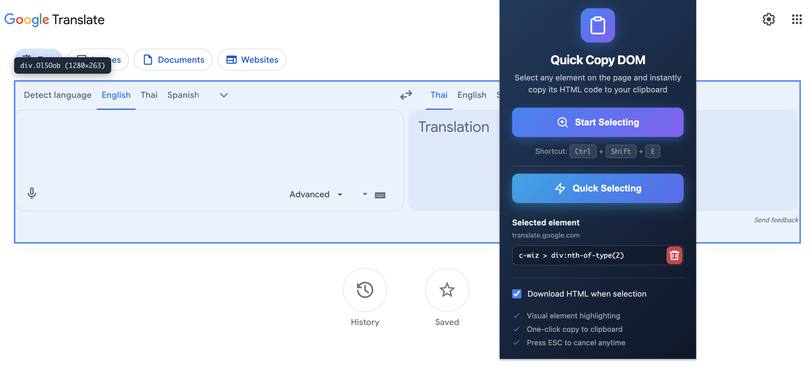

# Quick Copy DOM

<p align="center">
  
</p>

<p align="center">
  <strong>Select any element on a webpage and instantly copy its HTML to clipboard.</strong>
</p>

<p align="center">
  Like DevTools element inspector, but faster.
</p>

<p align="center">
  
</p>

---

## Features

- **Visual Element Selection** - Hover over elements to see them highlighted in real-time
- **Element Info Tooltip** - Shows tag name, classes, and dimensions while hovering
- **One-Click Copy** - Click any element to copy its complete outerHTML
- **Quick Selecting** - Each domain, including subdomains, keeps its own latest CSS selector. Hover **Quick Selecting** to highlight that element, then click to copy it again. Matching elements are still previewed as you edit the selector.
- **HTML File Download** - Optionally open a save dialog after selecting an element; filenames are based on the element's first heading or page URL
- **Keyboard Shortcut** - Quick access with `Ctrl+Shift+E` (or `Cmd+Shift+E` on Mac)
- **ESC to Cancel** - Press Escape to exit selection mode anytime
- **Lightweight** - No bloat, minimal permissions
- **Privacy First** - Works locally with no external data collection or transmission

## Installation

### From Chrome Web Store
*(Coming soon)*

### Manual Installation (Developer Mode)

1. Download or clone this repository
2. Open Chrome and navigate to `chrome://extensions/`
3. Enable "Developer mode" (toggle in the top-right corner)
4. Click "Load unpacked"
5. Select the `Quick Copy DOM` folder
6. The extension is now installed!

## Usage

1. **Activate the selector:**
   - Click the extension icon in your toolbar, OR
   - Press `Ctrl+Shift+E` (`Cmd+Shift+E` on Mac)

2. **Select an element:**
   - Move your mouse over the page
   - Elements will highlight as you hover
   - A tooltip shows the element's tag, classes, and size

3. **Copy the HTML:**
   - Click on any highlighted element
   - The complete HTML is copied to your clipboard
   - A toast notification confirms the copy

4. **Save and reuse a selector (optional):**
   - Selecting an element saves its CSS selector for that hostname. `www.example.com` and `example.com` are stored separately, and only the latest selector is kept for each one.
   - Open the popup on a tab to see that site's hostname and selector. Edit it and save a matching selector with the save button or Enter; the field previews matches as you type.
   - Hover **Quick Selecting** to highlight the saved element on the page. Click it to copy that element's HTML again, and to download the file when the download option is on.
   - Use the remove button to clear the selector for the current domain only.

5. **Download HTML (optional):**
   - Turn on **Download HTML when selection** in the popup
   - Selecting an element opens the browser's save dialog for an `.html` file; copying to the clipboard still happens
   - The filename uses the first heading in the selected HTML when available, otherwise it is based on the page URL

6. **Cancel selection:**
   - Press `ESC` to cancel without copying

## Permissions

| Permission | Reason |
|------------|--------|
| `activeTab` | To highlight and copy elements on the current page |
| `scripting` | To inject the selection functionality when activated or when previewing a selector |
| `downloads` | To show the save dialog and download selected HTML when the option is enabled |
| `storage` | To remember the latest CSS selector for each domain and the download preference locally |

This extension does **NOT**:
- Collect or transmit personal data or page content
- Track your browsing
- Make any network requests
- Access page content except when you activate selection, preview a CSS selector, or hover **Quick Selecting**
- Store copied page HTML in extension storage

## Development

### Project Structure

```
Quick Copy DOM/
├── manifest.json      # Extension configuration
├── background.js      # Service worker for keyboard shortcuts
├── content.js         # Element selection logic
├── download-name.js   # HTML download filename and document helpers
├── popup.html         # Extension popup UI
├── popup.js           # Popup interaction logic
├── PRIVACY.md         # Privacy policy
├── README.md          # Project documentation
├── icons/             # Extension icons
│   ├── icon16.png
│   ├── icon48.png
│   └── icon128.png
└── store/             # Chrome Web Store assets
    ├── description.txt
    ├── short-description.txt
    ├── promo-tile-small.png
    └── promo-tile-large.png
```

### Building for Production

The extension is ready to use as-is. To publish to the Chrome Web Store:

1. Zip the extension folder (excluding the `store/` directory)
2. Go to [Chrome Web Store Developer Dashboard](https://chrome.google.com/webstore/devconsole)
3. Create a new item and upload the zip file
4. Fill in the listing details using content from `store/`
5. Submit for review

## License

MIT License - feel free to use, modify, and distribute.

## Contributing

Contributions are welcome! Feel free to:
- Report bugs
- Suggest features
- Submit pull requests

---

<p align="center">
  Made with ❤️ for developers who value their time
</p>
